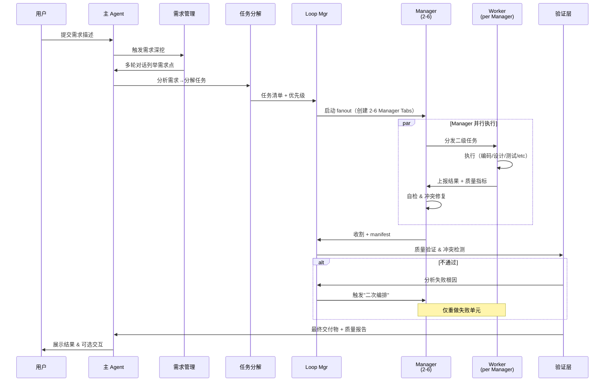

# 界王拳模式 V2：全自动 Agent 协调编排系统

> **核心升级**：从"静态分层并行"升级为"动态需求深挖→自动分配→Loop 管理→无监管运行"

---

## 📋 目录
1. [架构设计](#架构设计)
2. [运行流程](#运行流程)
3. [需求深挖协议](#需求深挖协议)
4. [Loop Management 模式](#loop-management-模式)
5. [Agent 自协调机制](#agent-自协调机制)
6. [实现路线图](#实现路线图)
7. [快速开始](#快速开始)

---

## 架构设计

### V2 核心改进

```
用户需求
  ↓
【主 Agent - 需求深挖阶段】
  ├─ 多轮对话，列举完整需求点
  ├─ 分类（功能/非功能/约束/风险）
  ├─ 识别优先级与依赖关系
  └─ 生成「需求白皮书」（JSON）
     ↓
【主 Agent - 编排启动阶段】
  ├─ 读取需求白皮书
  ├─ 自动分解任务
  ├─ 预估工作量与并行度
  ├─ 分配 Manager 数量（2-6）
  └─ 创建专属 workspace
     ↓
【Loop Management 层 - 自主运行】
  ├─ Manager-A（并行分支 1）
  │  ├─ 分发 2-6 个 Worker
  │  ├─ Worker 执行具体任务（编码/设计/测试）
  │  ├─ 结果汇聚
  │  └─ 自救机制（失败重试、冲突处理）
  ├─ Manager-B（并行分支 2）
  │  └─ ...同上
  └─ Manager-C（...）
     ↓
【验证与反馈循环】
  ├─ 各 Manager 自检质量
  ├─ 跨 Manager 冲突检测
  ├─ 必要时触发"二次编排"
  └─ 主 Agent 最终聚合 & 交付
```

---

## 运行流程

### 6 阶段工作流



---

## 需求深挖协议

### 目标
用户给出原始需求后，主 Agent **自动发起多轮对话**，系统化地列举所有需求点，无需人工干预。

### 协议步骤

#### 1️⃣ **初始分析**
主 Agent 解析用户需求，识别以下 5 个维度：

```json
{
  "request": "原始需求文本",
  "dimensions": {
    "functional": ["功能需求列表"],
    "non_functional": ["性能/可扩展性/安全/etc"],
    "constraints": ["预算/时间/资源/etc"],
    "risks": ["已识别的风险点"],
    "gaps": ["明显缺失或不清楚的点"]
  },
  "confidence_score": 0.65,
  "remarks": "需要深挖的问题清单"
}
```

#### 2️⃣ **多轮深挖（自动发起）**

主 Agent 针对 `gaps` 和低信心项自动向用户发起**标准化问题**：

```
第 1 轮：功能边界
"您提到的 X 功能，是否包括 A、B、C 三个子功能？有优先级差异吗？"

第 2 轮：非功能需求
"预期用户数、数据量、响应时间目标是多少？"

第 3 轮：技术栈偏好
"有技术栈偏好吗？（如 Python/Node.js/Go；MySQL/PostgreSQL；等）"

第 4 轮：风险与约束
"是否有安全合规要求？线上部署的时间压力？"

第 5 轮：验收标准
"这个需求如何验证成功？有具体的测试场景吗？"
```

#### 3️⃣ **需求白皮书生成**

汇总所有回答，主 Agent 自动生成结构化的需求白皮书（`.world-meta.json` 补充字段）：

```json
{
  "requirements_doc": {
    "title": "任务名称",
    "created_at": "2026-10-29T00:00:00Z",
    "user_answers": [
      {
        "round": 1,
        "question": "...",
        "answer": "..."
      }
    ],
    "functional_requirements": [
      {"id": "F1", "desc": "...", "priority": "high", "dependencies": []},
      {"id": "F2", "desc": "...", "priority": "medium", "dependencies": ["F1"]}
    ],
    "non_functional_requirements": [
      {"id": "NF1", "category": "performance", "spec": "响应时间 <200ms"}
    ],
    "constraints": [
      {"id": "C1", "type": "timeline", "value": "2 周内交付"}
    ],
    "validation_criteria": [
      {"id": "V1", "desc": "通过单元测试 + 集成测试"}
    ]
  }
}
```

---

## Loop Management 模式

### 核心机制

```bash
loop_management.sh
  ├─ 状态初始化
  │  ├─ 读取需求白皮书
  │  ├─ 任务分解 → 优先级排序
  │  └─ 生成 manifest（追踪所有 Manager + Worker 状态）
  │
  ├─ 启动阶段
  │  ├─ 创建专属 workspace（"界王拳 · 任务名 · ts"）
  │  ├─ fanout.sh → 启动 2-6 Manager
  │  └─ 记录 Manager PID + tab 关联
  │
  ├─ 循环监控（30 秒 × N 轮）
  │  ├─ 心跳检测（Manager 是否存活）
  │  ├─ 进度追踪（Worker 完成度）
  │  ├─ 冲突检测（是否有并行冲突）
  │  └─ 质量快速检查（早期告警）
  │
  ├─ 自救机制
  │  ├─ Manager 故障 → 自动重启该分支
  │  ├─ Worker 超时 → 自动重试（最多 3 次）
  │  ├─ 冲突检测 → 自动降级并行度或重新分片
  │  └─ 质量不达标 → 触发"二次编排"
  │
  └─ 收割与验证
     ├─ 所有 Manager 收割完成
     ├─ 结果聚合 & 去重
     ├─ 跨分支冲突验证
     └─ 交付给主 Agent
```

### Loop Manager 任务模板

```bash
#!/bin/bash

# loop-manager.sh: Loop 管理核心脚本

source lib/state-mgmt.sh
source lib/conflict-detect.sh

MANIFEST="$1"               # manifest 文件路径
MAX_ROUNDS="${2:-20}"       # 最多监控 20 轮（30 秒/轮 = 10 分钟）
HEARTBEAT_INTERVAL=30       # 心跳检测间隔（秒）
QUALITY_THRESHOLD=0.85      # 质量阈值

round=0
while (( round < MAX_ROUNDS )); do
  echo "[Loop:$(date +%s)] 第 $((round+1))/$MAX_ROUNDS 轮监控"
  
  # 1. 心跳检测
  if ! heartbeat_check "$MANIFEST"; then
    echo "❌ 心跳检测失败，触发自救..."
    auto_recovery "$MANIFEST"
  fi
  
  # 2. 进度追踪
  progress=$(get_progress "$MANIFEST")
  echo "📊 整体进度: ${progress}%"
  
  # 3. 冲突检测
  if detect_conflicts "$MANIFEST"; then
    echo "⚠️  检测到冲突，自动降级..."
    mitigate_conflicts "$MANIFEST"
  fi
  
  # 4. 质量快速检查
  quality=$(quick_quality_check "$MANIFEST")
  if (( $(echo "$quality < $QUALITY_THRESHOLD" | bc -l) )); then
    echo "⚠️  质量预警: $quality < $QUALITY_THRESHOLD"
  fi
  
  # 5. 检查收割条件
  if is_complete "$MANIFEST"; then
    echo "✅ 所有任务完成，准备收割"
    break
  fi
  
  sleep "$HEARTBEAT_INTERVAL"
  (( round++ ))
done

echo "🏁 Loop 管理结束，开始收割..."
```

---

## Agent 自协调机制

### 目标
Manager 间**自主协调**，无需主 Agent 持续干预。

### 核心机制

#### 1. **冲突自检**
每个 Manager 在分发 Worker 前，自动检查：
- 与其他 Manager 的工作是否有重叠？
- 依赖关系是否满足？
- 资源争用（如数据库连接）是否会冲突？

```bash
# Manager 启动前的冲突检测
check_conflict_with_peers "$MY_MANAGER_ID" "$MANIFEST" && {
  echo "✓ 无冲突，可以启动 Worker"
  fanout_workers
} || {
  echo "⚠️ 检测到潜在冲突，等待..."
  wait_for_dependency
  fanout_workers
}
```

#### 2. **自救逻辑**
- **Worker 超时**：Manager 自动重试（指数退避：1s → 2s → 4s）
- **Worker 失败**：尝试降级（如改为单线程而非并发）
- **Manager 故障**：主 Agent 检测到后自动重启该分支

#### 3. **进度同步**
所有 Manager 定期（每 30 秒）向 manifest 写入进度：
```json
{
  "manager_id": "mgr-a",
  "status": "running",
  "progress": 75,
  "workers_completed": 5,
  "workers_total": 6,
  "last_heartbeat": "2026-10-29T13:30:00Z"
}
```

#### 4. **二次编排**
当质量检查不达标时，主 Agent **自动分析根因** 并触发二次编排：
- 仅重做失败的单元（而非全部重来）
- 调整并行度（可能降低到单线程）
- 重新分配 Manager 资源

---

## 实现路线图

### Phase 1: 需求深挖 & 基础 Loop（1 周）
- [ ] `scripts/deep-requirements.sh` — 需求深挖交互脚本
- [ ] `lib/requirements-parser.sh` — 需求白皮书生成
- [ ] `scripts/loop-manager.sh` — Loop 管理核心
- [ ] `lib/state-mgmt.sh` — 状态管理（初始化、更新、心跳）
- [ ] 测试：端到端的一个简单任务（如"开发一个 CLI 工具"）

### Phase 2: 自协调 & 智能分片（1-2 周）
- [ ] `lib/conflict-detect.sh` — 冲突检测（不仅静态检查，还支持运行时检测）
- [ ] `lib/auto-recovery.sh` — 自救机制（重试、降级、重分配）
- [ ] `lib/cross-manager-sync.sh` — Manager 间状态同步
- [ ] 测试：模拟 Manager 故障、Worker 超时，验证自救

### Phase 3: 无监管运行 & 二次编排（2-3 周）
- [ ] `lib/quality-check.sh` — 质量检查与快速诊断
- [ ] `lib/second-orchestration.sh` — 二次编排逻辑
- [ ] `scripts/end-to-end-test.sh` — 完整 E2E 测试
- [ ] 生产就绪：容错、日志、诊断

### 实现优先级
1. **必需**：Phase 1 的需求深挖 + Loop 管理 → 确保基础框架能运行
2. **次要**：Phase 2 的冲突检测 + 自救 → 确保鲁棒性
3. **增强**：Phase 3 的二次编排 → 完全无监管运行

---

## 快速开始

### 最小化示例

```bash
# 1. 启动需求深挖
bash scripts/deep-requirements.sh \
  --request "开发一个全栈博客系统（前端 React + 后端 Node.js + MongoDB）" \
  --cwd "$PWD"

# 输出：自动生成需求白皮书，保存到 .world-meta.json

# 2. 启动界王拳编排
bash scripts/kaio-ken-orchestrate.sh \
  --request "全栈博客系统" \
  --max-managers 3 \
  --auto-mode 1 \
  --cwd "$PWD"

# 脚本自动执行：
#   ├─ 需求深挖 → 需求白皮书
#   ├─ 任务分解 → 分配给 3 个 Manager
#   ├─ 启动 fanout → 创建 Manager tabs
#   ├─ Loop 管理 → 监控 & 自救
#   ├─ 收割聚合 → 质量检查
#   └─ 最终交付 → 展示给用户

# 3. 完全无监管运行
# 脚本会自动处理：
#   - Manager 故障 → 自动重启
#   - Worker 超时 → 自动重试
#   - 冲突 → 自动降级或重分配
#   - 质量不达标 → 触发二次编排
```

### 监看进度（可选）

```bash
# 实时查看各 Manager 状态
watch -n 5 'cat .fangyang/manifest.json | jq ".managers"'
```

---

## 文件结构扩展

```
放羊了/
├── scripts/
│   ├── kaio-ken-orchestrate.sh          # 主编排脚本（已实现）
│   ├── deep-requirements.sh             # 需求深挖脚本【新增】
│   ├── loop-manager.sh                  # Loop 管理脚本【新增】
│   └── end-to-end-test.sh               # E2E 测试【新增】
├── lib/
│   ├── decompose.sh                     # 任务分解（已实现）
│   ├── state-mgmt.sh                    # 状态管理【新增】
│   ├── conflict-detect.sh               # 冲突检测【新增】
│   ├── auto-recovery.sh                 # 自救机制【新增】
│   ├── quality-check.sh                 # 质量检查【新增】
│   ├── cross-manager-sync.sh            # Manager 间同步【新增】
│   └── second-orchestration.sh          # 二次编排【新增】
├── templates/
│   ├── manager-task.md                  # Manager 任务模板（已实现）
│   ├── requirements-schema.json         # 需求白皮书 schema【新增】
│   └── manifest-schema.json             # Manifest 数据结构【新增】
├── KAIO_KEN.md                          # V1 文档（已实现）
├── KAIO_KEN_V2.md                       # V2 文档【本文件】
└── README.md                            # 更新：支持 V2
```

---

## 核心优势对标

| 对比项 | 单 Agent | 界王拳 V1 | 界王拳 V2 |
|--------|---------|----------|---------|
| **最大并行度** | 1 | 36 (6×6) | 36 (6×6) |
| **响应时间** | 线性 T | T/6 | T/6 ~ T/36（取决于任务分解）|
| **需求理解** | 单轮 | 单轮 | 多轮自动深挖 |
| **故障处理** | 手动重来 | Manager 层自救 | Manager + Worker 双层自救 |
| **无监管运行** | ❌ | ❌（需主 Agent 人工决策） | ✅（自动分析、自救、二次编排）|
| **质量保证** | 单次验证 | 分层验证 | 分层验证 + 二次编排 |
| **用户交互** | 被动式 | 被动式 | 主动深挖 + 最终反馈式 |

---

## 铁律（更新）

1. **主 Agent 先深挖，再启动**：任何编排前必须完成需求白皮书
2. **Manager 自检无冲突才能分发 Worker**
3. **Worker 执行中失败 Manager 自动重试，3 次失败才向主 Agent 报告**
4. **Loop 管理连续运行，不依赖人工干预**
5. **收割后自动验证跨分支冲突**
6. **质量不达标自动触发二次编排**
7. **主 Agent 只在两个时刻介入**：
   - 初始：需求深挖完成后确认启动
   - 终期：所有编排完成后展示结果
8. **所有操作可追踪**：manifest 记录完整审计日志

---

## 与用户的交互模式

```
用户输入需求
    ↓
主 Agent 自动发起 5 轮深挖对话
    ↓ 用户每轮简单回答
主 Agent 生成需求白皮书
    ↓
主 Agent 显示："需求已深挖完成，包括 F1-F8 功能、NF1-NF3 非功能需求、C1-C2 约束。
是否启动编排？[Y/n]"
    ↓ 用户确认
【自动运行，无需人工干预】
Loop 管理持续运行 10 分钟内完成大多数任务
    ↓
主 Agent 显示进度简报："进度 87%，预计还需 3 分钟..."
    ↓
【全部完成】
主 Agent 展示最终结果 + 质量报告
    ↓
用户可选：查看详细日志 / 二次调整 / 接受交付
```

---

## 下一步

1. **即刻**：实现 `deep-requirements.sh` 与需求白皮书解析
2. **Week 1**：完成 `loop-manager.sh` 与基础 `state-mgmt.sh`
3. **Week 2**：补全冲突检测 & 自救逻辑
4. **Week 3**：集成二次编排，运行完整 E2E 测试
5. **生产**：容错、日志、监控、文档完善

